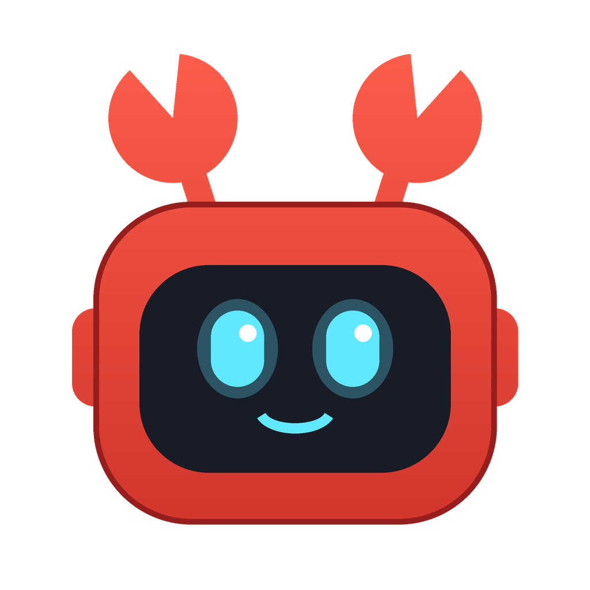
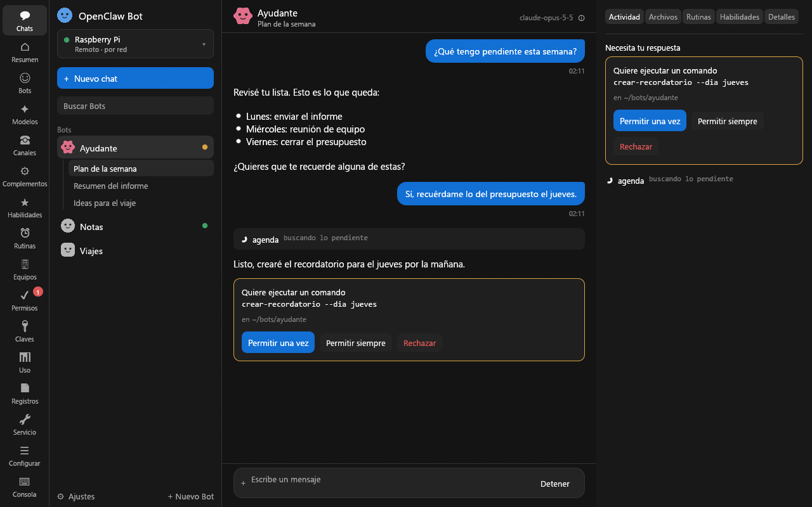
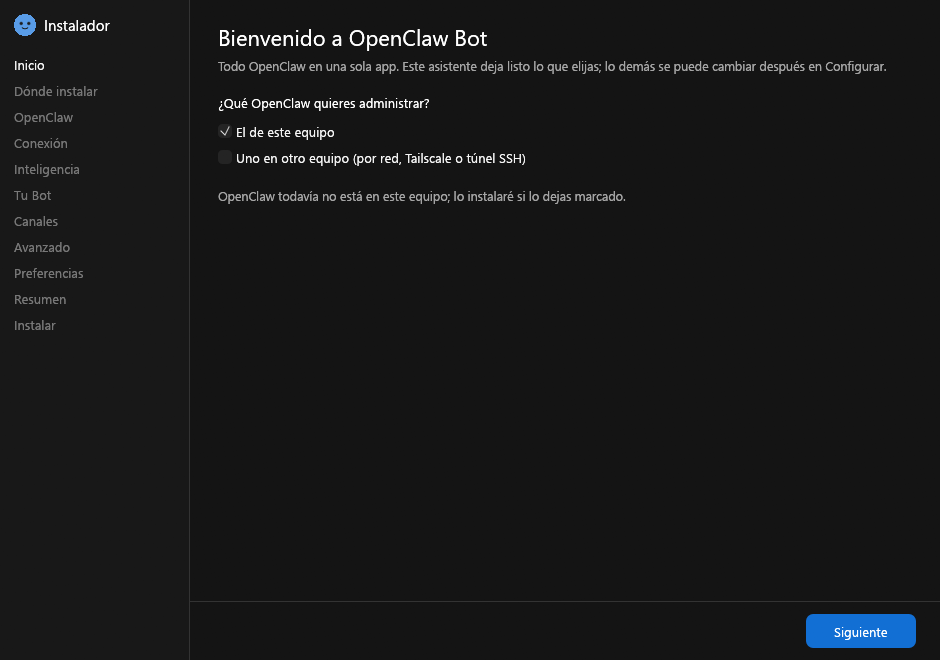

<p align="center">
  
</p>

<h1 align="center">OpenClaw Bot</h1>

<p align="center">
  Tus Bots de <a href="https://github.com/openclaw/openclaw">OpenClaw</a> en una app de escritorio para Windows:
  chats, aprobaciones y administración completa, en este equipo o en uno remoto.
</p>

<p align="center">
  <a href="https://github.com/elgodox/openclaw-bot/releases/latest"><b>⬇ Descargar el instalador</b></a>
</p>



## Qué hace

- **Chats con tus Bots**: conversaciones, archivos adjuntos, actividad en vivo y aprobaciones de comandos (permitir una vez, siempre o rechazar).
- **Local o remoto**: se conecta al OpenClaw de este equipo o a uno en otra máquina, por red, Tailscale o túnel SSH. Puedes guardar varias conexiones y cambiar entre ellas.
- **Administración de OpenClaw**: modelos, canales, complementos, habilidades, rutinas, equipos, permisos, claves, uso, registros, servicio, configuración y consola.
- **Flota**: administra tus propias máquinas (Linux y Windows) desde la app: inventario, comandos por SSH (con o sin admin), contraseñas de administrador cifradas y enrolamiento con una línea. Usa el toolkit de [`fleet/`](fleet/) (Headscale + SSH + RustDesk).
- **Instalador con asistente**: si OpenClaw no está instalado, lo instala y lo deja configurado (proveedor de IA, primer Bot, canales).
- **Se actualiza solo**: al abrirse busca versiones nuevas en GitHub y las instala con un clic.

## Instalar

1. Descarga **`OpenClaw-Bot-Setup.exe`** desde la [última versión](https://github.com/elgodox/openclaw-bot/releases/latest).
2. Ábrelo y sigue el asistente. Se instala solo para tu usuario, sin permisos de administrador, en `%LOCALAPPDATA%\Programs\OpenClaw Bot`.

> El programa no está firmado, así que Windows SmartScreen puede avisar la primera vez: elige **Más información → Ejecutar de todas formas**.



Para desinstalar: *Configuración de Windows → Aplicaciones → OpenClaw Bot → Desinstalar*.

## Flota (opcional)

La sección **Flota** usa un toolkit en Python que se descarga aparte:

1. Baja **`OpenClaw-Bot-Fleet.zip`** del [último release](https://github.com/elgodox/openclaw-bot/releases/latest) y descomprímelo.
2. Monta el servidor una vez (Headscale + RustDesk con Docker): ver [fleet/README.md](fleet/README.md).
3. En una terminal, dentro de `OpenClaw-Bot-Fleet/orchestrator`:

   ```bash
   python -m pip install -r requirements.txt
   ```

   ```bash
   python fleet.py config set-server
   ```

4. En la app, *Flota → Toolkit de flota*: elige la carpeta `orchestrator` y guarda.

Solo para administrar equipos propios: cada máquina se enrola con tu clave de pre-autorización y tu clave SSH.

## Actualizaciones

La app consulta el último release de este repositorio al abrirse y cada 6 horas. Si hay una versión más nueva aparece un aviso arriba con **Actualizar ahora**: descarga el programa nuevo, lo reemplaza y se reinicia. También puedes buscar a mano en *Configurar → Actualizaciones*.

## Compilar desde el código

Requiere [Rust](https://rustup.rs) (stable) en Windows.

```bash
cargo build --release
```

El resultado es `target/release/openclaw-bot.exe`. El mismo archivo es la app y su instalador: si su nombre contiene `setup` (o se abre con `--setup`) muestra el asistente de instalación.

## Publicar una versión nueva

1. Sube `version` en `Cargo.toml` (por ejemplo a `1.1.0`) y haz commit.
2. Crea y empuja la etiqueta:

   ```bash
   git tag v1.1.0 && git push origin main v1.1.0
   ```

GitHub Actions corre los tests, compila `OpenClaw-Bot-Setup.exe` y lo publica en el release. Las apps instaladas lo detectan solas.

## Licencia

[MIT](LICENSE). OpenClaw es un proyecto independiente; esta app no está afiliada a él.
